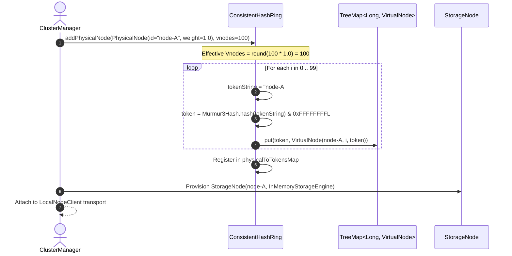
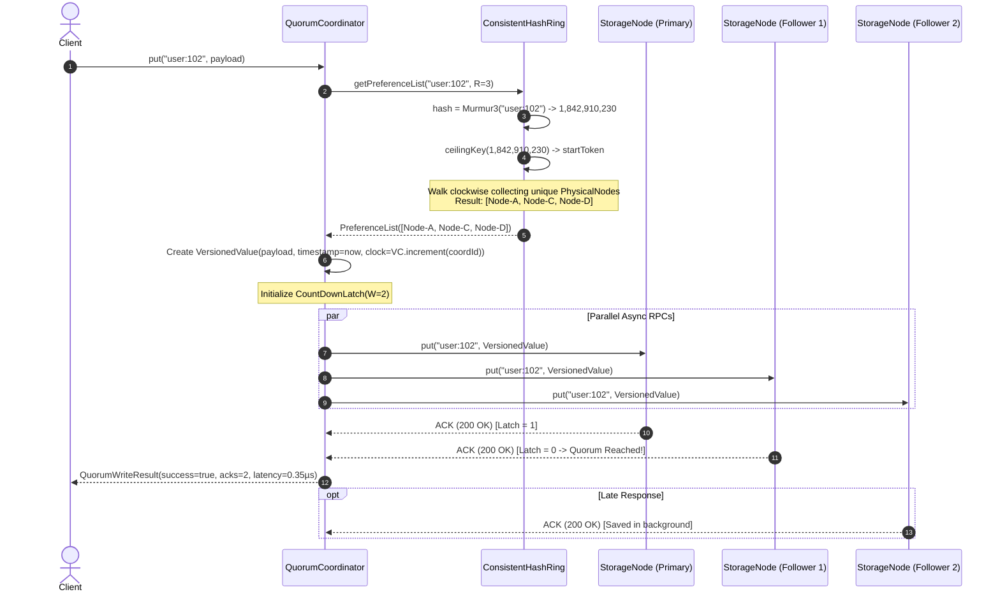
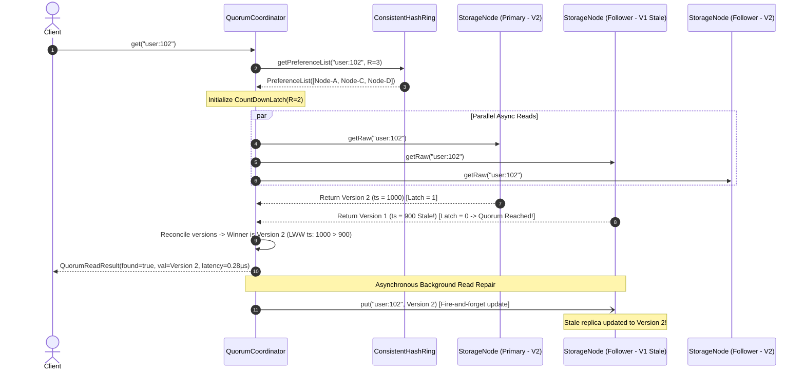

# End-to-End Architectural Workflow & Execution Guide
## Distributed Key-Value Router with Consistent Hashing & Quorum Replication

---

### System Blueprint & Component Interconnections

```
                         [ Client Application ]
                                   │
              HTTP / Java API      │  PUT("user:102", "{...}")
                                   ▼
      ┌─────────────────────────────────────────────────────────┐
      │                  QuorumCoordinator                      │
      │  - Enforces Quorum Config (N=3, W=2, R=2)               │
      │  - Generates Vector Clocks & Timestamps                 │
      │  - Dispatches Parallel Async RPCs via CompletableFuture │
      │  - Triggers Background Read Repair on Stale Replicas    │
      └──────────────┬───────────────────────────▲──────────────┘
                     │                           │
         Query Key   │                           │ Preference List
         Token       │                           │ [Node-A, Node-C, Node-D]
                     ▼                           │
      ┌──────────────────────────────────────────┴──────────────┐
      │                  ConsistentHashRing                     │
      │  - MurmurHash3_32bit Hash Space [0, 2^32 - 1]           │
      │  - TreeMap<Long, VirtualNode> (Red-Black Tree)          │
      │  - ceilingKey() & firstKey() for Clockwise Wrap-Around  │
      │  - Colocation Avoidance (Guarantees Distinct Hosts)     │
      └─────────────────────────────────────────────────────────┘
                                   │
                    Parallel Async RPCs via NodeClient
                                   │
             ┌─────────────────────┼─────────────────────┐
             ▼                     ▼                     ▼
     [ StorageNode A ]     [ StorageNode C ]     [ StorageNode D ]
     (Preference List)     (Preference List)     (Preference List)
     ┌───────────────┐     ┌───────────────┐     ┌───────────────┐
     │ KeyValueStore │     │ KeyValueStore │     │ KeyValueStore │
     │ VersionedVal  │     │ VersionedVal  │     │ VersionedVal  │
     │ Vector Clocks │     │ Vector Clocks │     │ Vector Clocks │
     └───────────────┘     └───────────────┘     └───────────────┘
```

---

### Workflow Phase 1: Cluster Initialization & Token Dispersion

When physical storage nodes join the cluster during bootstrapping, they register their virtual nodes on the consistent hash ring:



#### What Happens Internally:
1. **Weight Scaling:** The physical node's base virtual token count ($V = 100$) is multiplied by its capacity weight ($W = 1.0$).
2. **Deterministic Token Generation:** For each virtual index $i \in [0, 99]$, the string `"node-A#VN#" + i` is generated.
3. **Uniform Hash Mapping:** MurmurHash3 maps the string into a 32-bit unsigned integer $[0, 2^{32}-1]$.
4. **Collision Handling:** If a token collision occurs on the ring, the ring probes linearly to find the next available integer token.
5. **Red-Black Tree Insertion:** The token is inserted into `TreeMap<Long, VirtualNode>` in $O(\log N_v)$ time.

---

### Workflow Phase 2: Client Write Lifecycle (Quorum PUT with $W=2$)

A client issues an asynchronous write request: `put("user:102", "{\"role\":\"Admin\"}")`.



#### Step-by-Step Execution:
1. **Key Hash Computation:** The coordinator computes `hash("user:102")` using MurmurHash3.
2. **Clockwise Ceiling Lookup:** The ring queries `ring.ceilingKey(hash)`. If null (hash exceeds the highest ring token), it wraps around to `ring.firstKey()`.
3. **Preference List Assembly:** The ring advances clockwise token-by-token. For each virtual node encountered, it extracts its parent `PhysicalNode`. Duplicate physical IDs are skipped, guaranteeing $R = 3$ **distinct physical hosts**.
4. **Vector Clock Framing:** A `VersionedValue` envelope is instantiated containing the payload, current millisecond timestamp, and an incremented `VectorClock`.
5. **Parallel Non-Blocking Dispatch:** The coordinator uses `CompletableFuture` to dispatch three concurrent write calls across the network client transport.
6. **Quorum CountDownLatch:** A `CountDownLatch(W = 2)` awaits acknowledgments.
7. **Fast Return Path:** As soon as two replicas acknowledge success, the latch releases, and HTTP 200 / success is returned to the client without waiting for the third replica.

---

### Workflow Phase 3: Client Read Lifecycle with Read Repair (Quorum GET with $R=2$)

A client issues a read request: `get("user:102")`.



#### Step-by-Step Execution:
1. **Preference List Lookup:** Same $O(\log N_v)$ clockwise lookup resolves the preference list `[Node-A, Node-C, Node-D]`.
2. **Parallel Async Reads:** Reads are dispatched in parallel to all replicas.
3. **Quorum Gathering:** The coordinator collects responses until $R = 2$ responses arrive.
4. **Causal Conflict Resolution:**
   - The coordinator calls `VersionedValue.reconcile(resp1, resp2)`.
   - If one vector clock dominates the other, the descendant is chosen.
   - If concurrent, the higher wall-clock timestamp wins (Last-Write-Wins).
5. **Immediate Client Delivery:** The winning value is returned to the client.
6. **Automatic Read Repair:**
   - The coordinator inspects the returned responses.
   - It identifies that Node-C returned an older timestamp ($900 < 1000$).
   - It asynchronously issues `put("user:102", winningVersion)` to Node-C.
   - The stale replica is brought up to date without impacting read latency.

---

### Workflow Phase 4: Dynamic Node Addition & Partition Rebalancing

When a new node (`Node-E`) joins an existing cluster, only keys within the arcs intercepted by `Node-E`'s virtual nodes must migrate.

```mermaid
graph TD
    subgraph Pre-Join Topology (4 Nodes)
        A["Node-A (25% arc)"] --> B["Node-B (25% arc)"]
        B --> C["Node-C (25% arc)"]
        C --> D["Node-D (25% arc)"]
        D --> A
    end

    subgraph Node-E Joins Ring
        E["Node-E (20% target share)"]
        E -.->|Slices arc from A| A
        E -.->|Slices arc from B| B
        E -.->|Slices arc from C| C
        E -.->|Slices arc from D| D
    end

    subgraph Dynamic Data Migration
        Plan["PartitionRebalancer.planNodeAddition()"]
        Plan --> TaskA["Migrate keys in arc(A -> E)"]
        Plan --> TaskB["Migrate keys in arc(B -> E)"]
        Plan --> TaskC["Migrate keys in arc(C -> E)"]
        Plan --> TaskD["Migrate keys in arc(D -> E)"]
    end
```

#### Execution Steps:
1. **Token Allocation:** `Node-E` registers $V = 100$ virtual tokens on the ring.
2. **Delta Arc Analysis:** `PartitionRebalancer` scans the keys currently held in the cluster.
3. **Migration Plan Computation:**
   - For every key, its primary coordinator is evaluated before and after `Node-E`'s tokens were added.
   - Any key whose primary coordinator transitioned to `Node-E` is assigned to a `MigrationTask`.
4. **Data Streaming:** Versioned records are transferred directly from existing storage nodes to `Node-E`.
5. **Mathematical Assertion:** Exactly $\approx \frac{1}{N+1} = \frac{1}{5} = 20\%$ of keys are relocated. The remaining $80\%$ of keys stay on their original servers without movement!

---

### Workflow Phase 5: Hardware Failure & Chaos Engineering

When a primary node crashes:

```
[ Primary Node-A Crashes ]
           │
           ▼
[ Quorum Read / Write Dispatched ]
           │
           ├─► Node-A: Connection Refused / Timeout
           ├─► Node-C: Responds 200 OK
           └─► Node-D: Responds 200 OK
           │
           ▼
[ Quorum Evaluator ]
  - Required W = 2, Actual ACKs = 2 (Node-C, Node-D)
  - Quorum is SATISFIED!
  - Client operation SUCCEEDS with zero downtime!
```

If the cluster is configured with **Sloppy Quorums**:
1. When `Node-A` is dead, the coordinator advances to the next healthy successor physical machine on the ring (`Node-E`).
2. `Node-E` accepts the write and tags it with a **Hinted Handoff** marker: `Hint: Target=Node-A`.
3. When `Node-A` recovers from its hardware failure, `Node-E` replays the saved writes back to `Node-A`.

---

### Workflow Phase 6: How to Execute & Verify All Claims

The project includes an empirical verification suite that asserts every mathematical claim:

#### 1. Compile and Run the Test Suite
```bash
mvn clean test
```

#### What Tests Verify:
- `ConsistentHashRingTest`: Confirms clockwise search, boundary wrap-around, and physical colocation avoidance ($R$ distinct physical hosts).
- `VirtualNodesDistributionTest`: Asserts that distribution variance and standard deviation decay monotonically as $V$ increases from $1 \to 500$.
- `NodeChurnAndRebalancingTest`: Asserts that node addition relocates only $\approx \frac{K}{N+1}$ keys ($\pm 3\%$), whereas Modulo Hashing relocates over $>85\%$ of the keys.
- `QuorumReplicationTest`: Tests $W=2, R=2$ consistency, tolerates single node crash, fails when $<W$ nodes survive, and verifies automatic Read Repair on stale replicas.
- `RoutingLatencyBenchmarkTest`: Asserts that average ring route-resolution latency is strictly $< 5\text{ microseconds}$ per lookup (typically $< 0.5\text{ µs}$).

#### 2. Run the Interactive Demonstration CLI
To execute the interactive CLI with ASCII distribution charts, node churn comparison, and microbenchmarks:
```bash
mvn test-compile
java -cp "target/classes:$(mvn dependency:build-classpath | grep -A 1 'Dependencies classpath:' | tail -n 1)" com.distributedsystems.consistenthashing.Main
```
Or directly:
```bash
java -cp "target/classes:$HOME/.m2/repository/com/fasterxml/jackson/core/jackson-databind/2.17.0/jackson-databind-2.17.0.jar:$HOME/.m2/repository/com/fasterxml/jackson/core/jackson-core/2.17.0/jackson-core-2.17.0.jar:$HOME/.m2/repository/com/fasterxml/jackson/core/jackson-annotations/2.17.0/jackson-annotations-2.17.0.jar" com.distributedsystems.consistenthashing.Main
```
